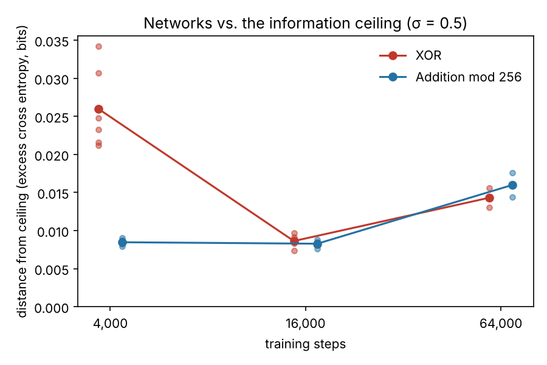
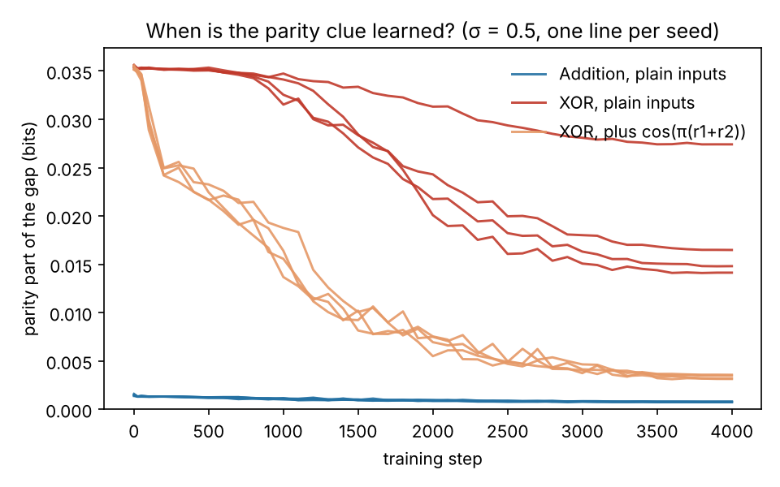
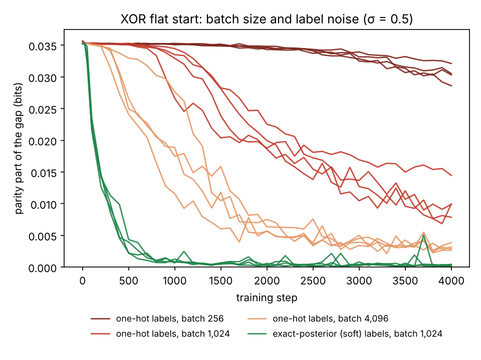
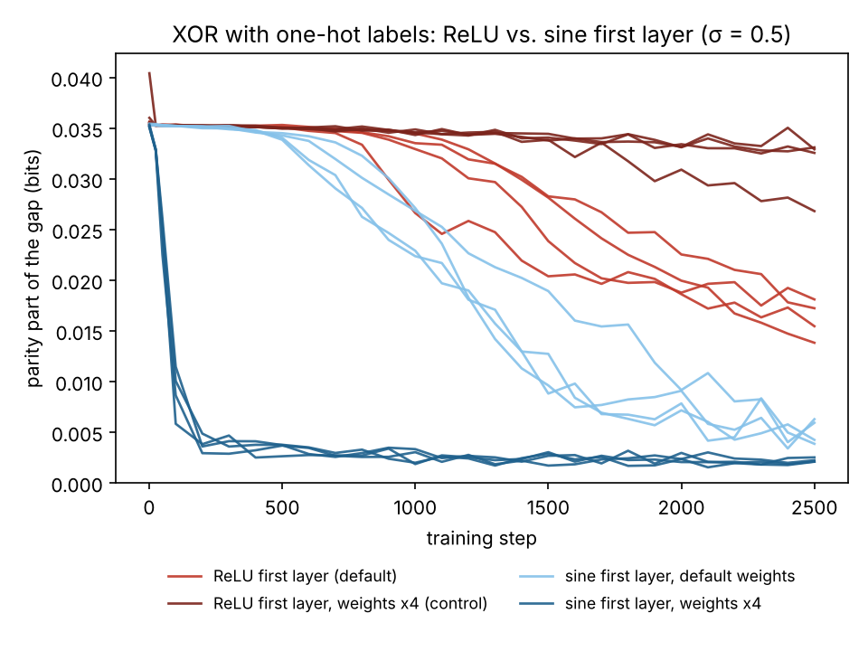
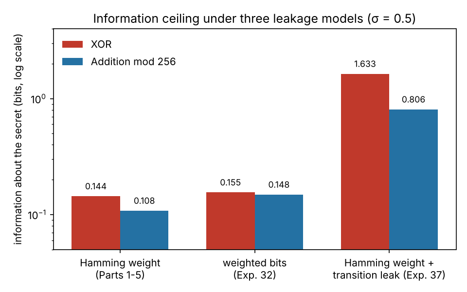

# XOR vs. Addition Masking: Less Information, or Harder to Learn?

A simulated study of why a neural network attacker learns one kind of masked secret more
slowly than another, written up in the order the work was done. Each part says what
question we asked, where the idea came from, which files answer it, what we found, and what
it led to next.

## Summary

When a neural network struggles to attack a masked secret, is it because the measurements reveal less
about the secret, or because the rule linking them to it is harder to learn? We separate the two in a
simulated setting: an 8-bit secret split into two shares, each leaking its Hamming weight plus Gaussian
noise. XOR masking leaks *more* information than arithmetic masking (0.144 vs 0.108 bits at σ = 0.5),
yet small neural networks need about four times more training to get as close to that limit. The extra
time goes into one clue, the parity of the secret's Hamming weight, which ordinary networks ignore for a
long flat start. Adding only the noise of one-hot training labels to otherwise clean training brings the
flat start back (1,450 vs 100 steps), showing that label noise causes it, and a sine first layer removes
it (100 vs 1,250 steps). The effect belongs to Hamming-weight leakage: with weighted-bit leakage both
XOR's advantage and the flat start disappear, while a transition leak between the shares raises XOR's
information from 0.144 to 1.63 bits. Everything here is simulated; nothing is measured on real hardware.

## Contents

- [Motivation and question](#motivation-and-question)
- [1. Is there less information?](#1-is-there-less-information) – the information ceiling
- [2. Do trained networks reach the ceiling?](#2-do-trained-networks-reach-the-ceiling) – XOR needs more training
- [3. Where does XOR fall short? The parity clue](#3-where-does-xor-fall-short-the-parity-clue) – a long flat start on parity
- [4. What causes the flat start?](#4-what-causes-the-flat-start) – batch size, label noise and a rule of thumb
- [5. Testing the cause directly](#5-testing-the-cause-directly) – label noise causes it; a sine layer removes it
- [6. Does it hold under other leakage models?](#6-does-it-hold-under-other-leakage-models) – weighted bits and a transition leak
- [7. Link to the adder project, checks, and open questions](#7-link-to-the-adder-project-checks-and-open-questions) – a LayerNorm test, how we checked, what is left
- [Related work](#related-work) and [Glossary](#glossary)
- Full lab notebook: [PROGRESS.md](PROGRESS.md)

Experiment numbers match the notebook: Experiment 30 is entry A-30 in PROGRESS.md, and its files
start with `a30`.

**Scope, up front:** everything here is simulated. The leakage model is mostly one simple
model (Hamming weight plus Gaussian noise), the networks are small MLPs, and nothing is
measured on a real device. Results are claims about this model only.

## Motivation and question

**[Masking](#masking)** is a standard defence against [side-channel attacks](#side-channel-attack), where an attacker learns a
secret from a device's power use or electromagnetic emissions. The device never handles the
secret `s` directly. It splits it into two random-looking pieces ([shares](#shares)), so that neither
piece alone says anything about `s`. Two common ways to split a byte:

- **Boolean masking ([XOR](#xor)):** shares `m` and `s XOR m`
- **Arithmetic masking (addition):** shares `m` and `(s + m) mod N` (see [mod N](#mod-n))

Deep-learning attacks train a neural network to read the secret from the leakage of both
shares together (for example, [MLPs](#mlp) and CNNs on a masked [AES](#aes) implementation in the ASCAD
study, [Prouff et al. 2018](https://eprint.iacr.org/2018/053)).

Suppose a network finds one masking harder to attack. There are two very different reasons
that could be:

1. **Information:** the measurements of that masking reveal *less* about the secret.
   Then it is genuinely better protection.
2. **Learnability:** the measurements carry the same or more information, but the rule
   linking them to the secret is *harder for a network to learn*. Then a network that fails
   says more about its training than about the protection.

These need different evidence, so the project separates them: first compute exactly how much
information is available, a ceiling no attacker can beat, then measure how close trained
networks get to it.

**Setup (used throughout).** The secret `s` is a byte (0–255, uniform), the mask `m` is a
fresh random byte. Each share leaks its **[Hamming weight](#hamming-weight)** (number of 1 bits) plus [Gaussian
noise](#gaussian-noise) with [standard deviation](#standard-deviation) σ. The attacker sees two noisy numbers, one [trace](#trace), and must guess `s`.
We chose this model because it is small enough to compute everything exactly. A published paper
uses the same kind of model for Boolean masking ([Cheng et al. 2021](https://arxiv.org/abs/2105.07436)), and Hamming-weight models
fit some real 8-bit chips ([Brier et al. 2004](https://www.iacr.org/archive/ches2004/31560016/31560016.pdf)), but that does not make it a model of any
particular device.

**Sources.** A claim goes into this write-up only if it is our own measurement or is supported
by a paper listed in [Related work](#related-work).

**Environment:** Python 3.13, CPU only, versions pinned in
[requirements.txt](requirements.txt).

## 1. Is there less information?

**Question.** Before asking why a network struggles, check whether the information is even
there. How many bits about `s` can *any* attacker get from one noisy reading of both shares?

**Where the idea came from.** Our own starting question (the information-versus-learnability
split). We later read [Masure et al. 2023](https://eprint.iacr.org/2022/863) and [Hiltenbrand et al. 2025](https://eprint.iacr.org/2025/604), which report the same direction for Boolean versus arithmetic masking, so this part
re-derives a published result as a check on our code, not a new finding.

**Files.**
- [ceiling.py](experiments/ceiling.py) – computes the information ceiling ([mutual information](#mutual-information) between
  the secret and the two noisy readings). For each secret it counts, over all 256 masks, the
  exact table of (weight of share 1, weight of share 2); adds the Gaussian noise; and
  integrates numerically on a grid (spacing σ/4).
- [tests_sanity.py](experiments/tests_sanity.py) – checks every fact the write-up relies on, for example
  that each share alone carries 0 bits, and the parity identity below.

```
cd experiments
python3 tests_sanity.py   # ~3 s, prints: all sanity checks passed
python3 ceiling.py        # ~3 s, prints the checks and the table below
```

**Result.** XOR leaks more than addition at every noise level (Table 1).

*Table 1. Information ceiling: bits an ideal attacker learns about the 8-bit secret from one trace.*

| Noise σ | XOR | Addition mod 256 |
|---|---|---|
| none | 1.150 | 0.275 |
| 0.5 | 0.144 | 0.108 |
| 1.0 | 0.047 | 0.037 |

Checks: each share alone gives 0 bits (to 1e-15), the noise density integrates to 1.00000, and
at small noise (σ = 0.15) the grid answer matches the exact noise-free value (1.1432 vs 1.1499 for XOR).

**What it answered.** XOR leaks **more** than addition at every noise level tested, so in this
model "XOR is harder because it reveals less" is ruled out. One bit of XOR's noiseless 1.150 has
a simple explanation: under XOR, the [parity](#parity) of the two readings' sum equals the parity of the
secret's own Hamming weight (checked for all 65,536 secret–mask pairs), and that parity splits
the 256 secrets exactly in half. [Masure et al. 2023](https://eprint.iacr.org/2022/863) state the same identity; we found it first
and read it there afterwards.

**What it raised.** If XOR has more information, then any difficulty a network has with XOR is
about *learning*. Next: do trained networks actually reach these limits?

## 2. Do trained networks reach the ceiling?

**Question.** [Part 1](#1-is-there-less-information) says XOR leaks more. So does a trained network actually get close to
that limit, and does it get as close for XOR as for addition?

**Where the idea came from.** To measure how much a network has
extracted we use [perceived information](#perceived-information), as in
[Masure, Dumas & Prouff 2019](https://eprint.iacr.org/2019/439), and we rely on
[Bronchain et al. 2019](https://eprint.iacr.org/2019/132) for why it can never exceed the true
information. The network (an [MLP](#mlp)) and optimizer ([Adam](#adam)) were default choices,
not taken from a paper.

**How we measure the gap.** For each trace, the network outputs a probability for each of the
256 possible secrets. We score it with its [cross entropy](#cross-entropy): how surprised it is,
on average, by the true secret, in bits. A network that only guesses has a cross entropy of
8 bits; whatever it learns lowers that number. The drop is its
**[perceived information](#perceived-information) (PI)**, the bits about the secret it actually
extracted:

`PI = 8 bits − cross entropy`

PI can never go above the ceiling from [Part 1](#1-is-there-less-information), so we report the
**gap**, the information the network left unused:

`gap = ceiling − PI`

A gap of 0 would be a perfect attacker. Example: at σ = 0.5 the XOR ceiling is 0.144 bits, so an
XOR network with a gap of 0.026 bits has extracted about 0.118 bits, about 82% of what is possible.

**Files.**
- [train_mlp.py](experiments/train_mlp.py) – simulates traces, trains the network, measures PI.
  Experiment 2: 60 runs over noise levels and training-set sizes. Results in
  [results_mlp.json](experiments/results_mlp.json).
- [a03_budget.py](experiments/a03_budget.py) and [overnight_queue.py](experiments/overnight_queue.py) –
  Experiment 3 (training length, 6 [seeds](#seed) per masking) and Experiments 4–8 (learning rate,
  noise, data size, network size, noise-free data). Results in [a03/](experiments/a03) and
  [overnight/](experiments/overnight). The queue is resumable: it skips runs already in its result files.
- [summarize.py](experiments/summarize.py) – rebuilds every number in this part from the saved results.
- [plot_ch2.py](experiments/plot_ch2.py) – draws the figure below.

```
cd experiments
python3 summarize.py      # seconds: all tables in this part, from saved results
python3 plot_ch2.py       # seconds: the figure below
# to rerun the training itself (CPU, slow):
python3 train_mlp.py results_mlp.json 0.5,1.0 2000,10000,50000,250000,1000000 2 4000   # ~1 hour
python3 a03_budget.py a03/stage1_4k 4000 0,1,2,3,4,5                                   # ~12 min
QUEUE_LIMIT_S=6300 python3 overnight_queue.py overnight                                # many hours
```

**Result 1: networks get close, but XOR less so (Experiment 2).** With 1,000,000 training traces
the networks reach 80–95% of the ceiling, and none exceed it, which is the check we wanted. With
only 2,000–10,000 traces every network [overfits](#overfitting). At σ = 0.5, though, XOR networks
are about three times further from their ceiling than addition networks (0.022–0.031 vs
0.008 bits, 2 seeds).

**Result 2: the gap is about training time (Experiment 3, σ = 0.5, 6 seeds).** Figure 1 shows
each run; Table 2 gives the averages.



*Figure 1. Gap from the information ceiling after 4,000, 16,000 and 64,000 training steps
(σ = 0.5, 1,000,000 training traces). Small dots are individual runs; large dots joined by
lines are averages. Lower is better.*

*Table 2. Average gap from the ceiling (bits) by training length.*

| Training steps | XOR | Addition |
|---|---|---|
| 4,000 | 0.0260 | 0.0085 |
| 16,000 | 0.0086 | 0.0083 |
| 64,000 (3 seeds) | 0.0143 | 0.0160 |

At 4,000 steps every addition run has a smaller gap than every XOR run (worst addition 0.0090,
best XOR 0.0212), and XOR's runs vary about 13 times more.
At 16,000 steps the gap is gone: addition was already at its level by 4,000 steps, while XOR
needed four times longer to get there. At 64,000 steps both got *worse*, a puzzle we come back
to in [Part 4](#4-what-causes-the-flat-start).

**Result 3: what the 4,000-step gap depends on (Experiments 4–8, 3–4 seeds each).**
- [Learning rate](#learning-rate): no value from 0.0005 to 0.008 closes it.
- Network shape: a deeper network closes most of it (depth 5: 0.0101 vs 0.0070), a shallower one
  widens it (depth 2: 0.0439 vs 0.0155), and width alone does not help.
- Training data: with less data XOR falls further behind (200,000 traces, best checkpoint: 0.049 vs 0.028).
- Noise: at 16,000 steps XOR is never clearly further from its ceiling than addition (about equal at
  σ = 0.5 and 0.75), and at low noise (σ = 0.25) it is clearly closer (0.013 vs 0.030).
- Noise-free data: trained on the exact probabilities, all 20 XOR networks learn the parity
  clue from [Part 1](#1-is-there-less-information) almost perfectly (0.999 of their probability on answers with the right parity).

**What it answered.** XOR isn't harder because the network can't reach its limit. Given enough
steps, depth or data, it gets there. XOR simply needs *more training* to get as close as addition.

**What it raised.** Why does XOR need more training? Experiment 8 hints at an answer: the parity
clue. Next we look at where exactly XOR's networks fall short, and when during training they
learn the parity.

## 3. Where does XOR fall short? The parity clue

**Question.** [Part 2](#2-do-trained-networks-reach-the-ceiling) showed that XOR networks need more
training. Which part of the job is slow? Our guess: the [parity](#parity) clue from
[Part 1](#1-is-there-less-information). Under XOR, whether the secret has an even or odd number of
1 bits shows up as whether the two readings add up to an even or odd number. As a function of the
readings, that flips every time their sum moves by one, a zigzag the network has to build out of
plain numbers. Addition has no such clue.

**Where the idea came from.** Our own reasoning from earlier results: the parity identity
([Part 1](#1-is-there-less-information)), deeper networks helping, and noise-free XOR networks learning parity
([Part 2](#2-do-trained-networks-reach-the-ceiling)). We found papers on the same theme only afterwards:
[Rahaman et al. 2019](https://arxiv.org/abs/1806.08734) (networks learn smooth, low-frequency
patterns before zigzag, high-frequency ones), [Tancik et al. 2020](https://papers.neurips.cc/paper_files/paper/2020/file/55053683268957697aa39fba6f231c68-Paper.pdf)
(feeding a network sine and cosine features makes zigzag patterns easy), and a study of real masked
AES traces that also sees parity learned late ([arXiv:2502.00384](https://arxiv.org/abs/2502.00384)).
Experiment 10 was designed after reading the first two; Experiment 11 tests an idea from
[Barak et al. 2022](https://proceedings.neurips.cc/paper_files/paper/2022/file/884baf65392170763b27c914087bde01-Paper-Conference.pdf) that parity is learned after a long flat stretch.

**How we split the gap.** Guessing the secret can be done in two stages: first guess its parity
group (even or odd number of 1 bits), then the secret inside that group. The
[cross entropy](#cross-entropy) splits exactly the same way, so the gap splits into a
**parity part** and a **within part**, each compared with the best possible attacker (the
[exact posterior](#exact-posterior)) on the same test traces.

**Files.**
- [parity_tests.py](experiments/parity_tests.py) – Experiment 9: splits the gap into the two parts,
  and trains with extra inputs that hand the network a parity-like clue. Results in [a09/](experiments/a09).
- [parity_tests_a10.py](experiments/parity_tests_a10.py) – Experiment 10: extra inputs at the wrong
  frequency, a shifted phase, or random frequencies ([Fourier features](#fourier-features)). Results in [a10/](experiments/a10).
- [a11_curves.py](experiments/a11_curves.py) – Experiment 11: records the parity part at every 100
  training steps on a [validation set](#validation-set). Results in [a11/](experiments/a11).
- [summarize_part3.py](experiments/summarize_part3.py) – rebuilds every number below and draws Figure 2.

```
cd experiments
python3 summarize_part3.py         # seconds, from saved results
# to rerun the training (4 seeds each, about 1-4 minutes per run on CPU):
python3 parity_tests.py a09
python3 parity_tests_a10.py a10
python3 a11_curves.py a11
```

**Result 1: the shortfall is the parity part (Experiment 9, 4 seeds).** At 4,000 steps, 72% of
XOR's gap is the parity part (Table 3). With four times more training it almost disappears, while
the within part stays the same for both maskings.

*Table 3. The gap (bits) split into its parity part and within part.*

| Masking, training steps | Gap | Parity part | Within part |
|---|---|---|---|
| XOR, 4,000 | 0.0248 | 0.0180 | 0.0068 |
| XOR, 16,000 | 0.0079 | 0.0014 | 0.0065 |
| Addition, 4,000 | 0.0090 | 0.0007 | 0.0083 |
| Addition, 16,000 | 0.0086 | 0.0005 | 0.0081 |

**Result 2: handing over a zigzag input removes most of the gap (Experiments 9–10, 4 seeds).** Each
extra input is computed only from the two noisy readings `r1` and `r2`, never from the answer.

*Table 4. XOR gap at 4,000 steps with different extra inputs. The sine and cosine inputs leave
addition unchanged (0.0080 to 0.0094).*

| Extra input | XOR gap | Parity part |
|---|---|---|
| none (plain readings) | 0.0248 | 0.0180 |
| `r1 + r2` (linear control) | 0.0322 | 0.0245 |
| `cos(π(r1+r2))`, the parity zigzag | 0.0106 | 0.0039 |
| `cos(π(r1+r2) + π/4)`, shifted | 0.0130 | 0.0058 |
| `cos(π/2 (r1+r2))`, half frequency | 0.0119 | 0.0053 |
| `cos(2π(r1+r2))`, double frequency | 0.0306 | 0.0234 |
| 16 random sine and cosine features | 0.0088 | 0.0009 |

The parity zigzag removes about 90% of the gap between XOR and addition, and 16 random sinusoids
work just as well. A plain extra input does not help, and neither does a zigzag twice too fast
(which equals 1 at every whole-number sum, so it carries no parity). We predicted the
half-frequency input would not help. It did, so the strict "only the exact frequency works" idea is
wrong. What helps is giving the network *some* oscillating input to build from.

**Result 3: a long flat start (Experiment 11, 4 seeds).**



*Figure 2. Parity part of the gap during training, one line per seed. Plain XOR networks (red) learn
nothing about parity for about the first 1,000 steps, then improve slowly at different times; one seed
is still far off at step 4,000. With the zigzag input (orange) the drop starts at once. Addition (blue)
has almost no parity information to learn.*

With plain inputs, the parity part first falls below half its starting value at step 2,300, 2,800
and 3,200 in three seeds, and never in the fourth. With the zigzag input it does so at steps 900 to
1,200 in all four. We predicted a flat start followed by a *sudden* drop. The flat start is real,
but the drop is gradual.

**What it answered.** XOR's extra training time goes mostly into one thing: the parity clue. The
network spends a long time learning nothing about it, apparently because building a zigzag out of
plain readings is hard, and any oscillating input shortcuts that.

**What it raised.** *Why* the long flat start? Is the parity signal too weak, is it hidden by noise
in training, or does it depend on settings like batch size and learning rate? That is the subject of
[Part 4](#4-what-causes-the-flat-start).

## 4. What causes the flat start?

**Question.** [Part 3](#3-where-does-xor-fall-short-the-parity-clue) found that plain XOR networks learn
nothing about the parity clue for about the first 1,000 steps. What sets the length of that flat start?
We tested the usual suspects one at a time: how strong the parity signal is, the
[learning rate](#learning-rate), the [batch size](#batch-size), the network's width, reusing the same
training data, and the noise in the training labels.

**Where the ideas came from.** Mostly from our own previous result each time: each experiment below
was chosen because the one before it pointed there. The fresh-data comparison follows the framing of
[Nakkiran et al. 2021](https://arxiv.org/abs/2010.08127) (training on a fixed set versus fresh
samples). Two experiments (unequal noise on the two shares, and splitting Adam's two internal
averages) replicate suggestions from an outside discussion in our own code before we relied on them.

**What we measure.** The **flat start** is the first training step at which the parity part of the gap
has fallen below 90% of its starting value. Shorter is better. We report the median over seeds; if a seed never gets there within the run, the median is over the seeds that did.

**Files.**
- [a12_runs.py](experiments/a12_runs.py) – Experiments 12–14: fresh data every step, a longer
  learning-rate schedule, and different noise levels. Results in [a12/](experiments/a12).
- [a15_runs.py](experiments/a15_runs.py), [a16_runs.py](experiments/a16_runs.py) – Experiments 15–16:
  learning rate, batch size and width. Results in [a15/](experiments/a15), [a16/](experiments/a16).
- [a17_runs.py](experiments/a17_runs.py), [a18_runs.py](experiments/a18_runs.py) – Experiments 17–18:
  training on [soft labels](#soft-label) instead of [one-hot labels](#one-hot-label), and mixtures of the two.
  Results in [a17/](experiments/a17), [a18/](experiments/a18).
- [a19_runs.py](experiments/a19_runs.py), [a22_runs.py](experiments/a22_runs.py),
  [a27_runs.py](experiments/a27_runs.py) – Experiments 19, 22 and 27: tests of a rule of thumb for the
  flat start. Results in `a19/`, `a19b/`, `a22a/`–`a22e/`, `a27/`, `a27b/`.
- [a20_runs.py](experiments/a20_runs.py), [a25_runs.py](experiments/a25_runs.py) – Experiments 20 and 25:
  64,000-step runs on fixed versus fresh data. Results in `a20f/`, `a20r/`, `a25f/`, `a25r/`.
- [a23_runs.py](experiments/a23_runs.py), [a24_runs.py](experiments/a24_runs.py),
  [a26_snr.py](experiments/a26_snr.py) – Experiments 23, 24 and 26: unequal share noise, Adam's two
  averages, and a direct measurement of [gradient](#gradient) noise.
- [summarize_part4.py](experiments/summarize_part4.py) – rebuilds every number below and draws Figure 3.

```
cd experiments
python3 summarize_part4.py     # seconds, from saved results
# each experiment script reruns its training; see the usage line at the top of each file
```

**Result 1: a stronger signal shortens it, but doesn't remove it (Experiment 14, 4 seeds).** With less
noise the parity clue is much stronger, and the flat start shrinks from about 1,100 steps at σ = 0.5 (the [Part 3](#3-where-does-xor-fall-short-the-parity-clue) setting) to
about 550 at σ = 0.35 and 300 at σ = 0.25. But even at σ = 0.25, after 4,000 steps XOR still has three
times addition's gap. Signal strength matters, but it isn't the whole story.

**Result 2: noise in training is the main driver (Experiments 15–18 and 26).**



*Figure 3. Parity part of the gap during training for plain XOR networks, one line per seed. Bigger
batches shorten the flat start; training on exact-posterior (soft) labels removes it.*

*Table 5. Flat start (training steps, median of seeds) under different training settings. XOR, σ = 0.5,
learning rate 0.002, batch 1,024 unless stated.*

| Setting | Flat start |
|---|---|
| batch 256 | 3,400 (one of 4 seeds never got there) |
| batch 1,024 | 1,250 |
| batch 4,096 | 400 |
| learning rate 0.0005 / 0.001 / 0.004 | 1,900 / 1,750 / 1,300 |
| width 64 / 1,024 (instead of 256) | 1,750 / 1,250 |
| soft labels (exact posterior) | 100 |
| 3% / 10% / 30% one-hot mixed into the soft labels (2 seeds) | 100 / 150 / 250 |

- **Batch size matters a lot:** four times the batch cuts the flat start about threefold. Learning rate and
  width matter much less, and a larger learning rate stops helping above 0.002.
- **Clean labels remove it entirely.** Normally each training example is labelled with its true secret
  (a one-hot label). But one noisy trace only weakly determines the secret, so from the network's point
  of view these labels are mostly noise. Training instead on the exact probabilities of each secret
  (soft labels) makes the flat start disappear (100 steps in every seed) and the final gap 45 times
  smaller (0.0005 vs 0.0218 bits). Mixing in more one-hot label brings the flat start back smoothly.
- **The gradient is measurably noisier (Experiment 26).** At the start of training, the one-hot and soft
  label gradients point the same way on average, but the one-hot gradient is about 900 times noisier.
  At batch 1,024 its [signal-to-noise ratio](#signal-to-noise-ratio) is about 0.3, meaning the noise is
  bigger than the signal, while the soft-label gradient's is 200–300.
- **The noise sits in Adam's update direction (Experiment 24).** Feeding [Adam](#adam) the soft-label
  gradient for its update direction, while keeping the one-hot gradient for its step-size estimate,
  recovers most of the benefit (parity part 4 times smaller after 4,000 steps).

Together these point to one explanation: the parity signal in each batch is small, and one-hot label
noise drowns it, so the network needs many steps or large batches to average the noise away. This is
still a correlation-based case. The direct causal test is in [Part 5](#5-testing-the-cause-directly).

**Result 3: a rule of thumb that predicts the flat start (Experiments 19, 22, 27).** No single
combination of learning rate and batch size (such as their ratio) describes the flat start
(Experiment 19). So we fitted a small formula instead:

`ln T = 17.227 + 1.660 ln(lr) + 0.144 ln(lr)² − 0.772 ln(B)`

where T is the flat start, lr the learning rate, B the batch size and ln the natural log.

*How we got it.* We wanted the simplest shape that fits what Experiments 15 and 16 showed: the flat start
falls steadily with batch size, so ln T is a straight line in ln(B); and it first shortens, then lengthens
again as the learning rate grows, so ln T gets a squared term in ln(lr). We fitted the four numbers by
least squares to the median flat starts of the six settings in Experiments 15 and 16 only. Then we tested
it twice without refitting: on the four settings of Experiment 19, which the fit had not seen (3 of 4 within
30%), and on four brand-new settings whose predictions we wrote down *before* running them (Experiment 22,
Table 6), where every prediction landed within 17% of the observed value.

*Its limits.* Four numbers fitted to six settings is a thin fit, and the squared term was chosen after
seeing Experiment 15, so this is a description of the flat start, not an explanation. It also stops
working above a batch of about 4,000: at batch 8,192 and 16,384 the flat start is 1.5–1.8 times longer
than predicted (Experiment 27). From Experiment 26 we estimate that the gradient's signal-to-noise ratio
reaches 1 near a batch of 3,400, so a likely reading is that beyond that point extra batch no longer
removes noise that matters.

*Table 6. Flat start predicted by the formula before running, and observed (median of 4 seeds).*

| Learning rate, batch | Predicted | Observed |
|---|---|---|
| 0.002, 512 | 2,114 | 1,850 |
| 0.001, 2,048 | 850 | 800 |
| 0.003, 1,024 | 1,203 | 1,450 |
| 0.0005, 4,096 | 670 | 700 |

**Result 4: the Part 2 puzzle is data reuse (Experiments 20 and 25, 2 seeds).** Both maskings got worse
between 16,000 and 64,000 steps in [Part 2](#2-do-trained-networks-reach-the-ceiling). The same 64,000-step
runs with a fresh batch drawn at every step don't get worse (Table 7). With the fixed set of 1,000,000
traces, each trace is seen about 65 times and the networks start memorizing noise, mostly by treating
secrets with the same Hamming weight differently ([overfitting](#overfitting)).

*Table 7. Gap after 64,000 steps (bits), fixed training set vs a fresh batch every step.*

| | Fixed 1M traces | Fresh batches |
|---|---|---|
| XOR | 0.0131, 0.0132 | 0.0005, 0.0008 |
| Addition | 0.0182, 0.0139 | 0.0022, 0.0019 |

**Ruled out along the way.** Fresh data does *not* clearly reduce the parity part at 4,000 steps
(Experiment 12: changes stay within seed-to-seed variation), so data reuse explains the late worsening
but not the parity delay. Stretching the learning-rate schedule does not change the first 2,000 steps
(Experiment 13). With unequal noise on the two shares, one-hot labels
still give a flat start of 1,400–2,300 steps and soft labels still remove it (Experiment 23).

**What it answered.** The flat start is mainly a noise problem: a weak parity signal hidden by the noise
of one-hot labels in each batch. Bigger batches reduce it, clean labels remove it, and a simple formula
predicts its length within its range.

**What it raised.** So far the evidence is circumstantial: soft labels change more than just the noise.
Can we add *only* the noise and bring the flat start back? And is the weak signal a property of how the
network represents parity, so that a different kind of network would not need to wait?

## 5. Testing the cause directly

**Question.** [Part 4](#4-what-causes-the-flat-start) built a case that one-hot label noise hides a weak
parity signal. But switching to soft labels changes more than the noise, so that case is circumstantial.
Two direct tests: (1) keep the clean training signal and add back *only* the noise. Does the flat start
return? (2) If the signal is weak because a normal network has to build the parity zigzag out of plain
pieces, does a network that can oscillate from the start skip the wait?

**Where the ideas came from.** Test 1 is our own design, the missing step after [Parts 3](#3-where-does-xor-fall-short-the-parity-clue)–[4](#4-what-causes-the-flat-start). Test 2 follows
our [Part 3](#3-where-does-xor-fall-short-the-parity-clue) finding that any oscillating input helps, plus [Ziyin et al. 2020](https://arxiv.org/abs/2006.08195),
who argue that ordinary networks handle periodic patterns poorly and propose periodic activations. We also
checked whether the result depends on the optimizer, and how the network's starting weight scale matters,
because a larger starting scale had sped things up in our companion adder project.

**Files.**
- [a30_noise_inject.py](experiments/a30_noise_inject.py) – Test 1: clean-label training plus pure
  label noise, at full and 0.3× strength. Scored by [a30_score.py](experiments/a30_score.py). Results in [a30/](experiments/a30).
- [a34_periodic.py](experiments/a34_periodic.py) – Test 2: the first hidden layer uses `sin` instead of
  ReLU. The same script runs the ReLU control (`ACT=relu`), the weaker-signal check (`SIG=0.6`) and
  fresh data (`FRESH=1`). Results in [a34/](experiments/a34), [a39/](experiments/a39), [a41b/](experiments/a41b), [a42/](experiments/a42).
- [a33_sgd.py](experiments/a33_sgd.py) – Test 1's question with momentum SGD instead of Adam. Results in [a33/](experiments/a33).
- [a28_runs.py](experiments/a28_runs.py), [a31_runs.py](experiments/a31_runs.py), [a35_move.py](experiments/a35_move.py) –
  starting weight scale and how far the weights move. Results in `a28_*/`, `a29_*/`, `a31/`, `a31b/`, `a31c/`, `a35/`.
- [summarize_part5.py](experiments/summarize_part5.py) – runs every scorer above on the saved results and draws Figure 4.

```
cd experiments
python3 summarize_part5.py                          # seconds, from saved results
# to rerun the training (about 2-4 minutes per run on CPU):
K=1 SEEDS="0 1 2 3" python3 a30_noise_inject.py a30
WS=4 SEEDS="0 1 2 3" python3 a34_periodic.py a34      # sine layer
ACT=relu WS=4 SEEDS="0 1 2 3" python3 a34_periodic.py a39
```

**Result 1: adding only the noise brings the flat start back (Experiment 30, 4 seeds).** We trained on the clean
exact-posterior gradient and added a zero-average noise term with exactly the statistics of one-hot labels.
The average training signal is unchanged; only the noise is new. The flat start comes back in full, and a
third of the noise gives a short one (Table 8). This is the causal test: in this setting, label noise in
the gradient *causes* the flat start.

*Table 8. Flat start (median of 4 seeds) and parity part after 4,000 steps, XOR, σ = 0.5, using the
hand-written Adam of Experiment 24 so the noise can be added exactly.*

| Training signal | Flat start (steps) | Parity part at 4,000 (bits) |
|---|---|---|
| clean labels | 100 | 0.0004 |
| clean labels + 0.3× label noise | 250 | 0.0019 |
| clean labels + full label noise | 1,450 | 0.0101 |
| ordinary one-hot labels | 1,150 | 0.0105 |

**Result 2: it isn't specific to Adam (Experiment 33, 4 seeds).** With momentum SGD instead of Adam, one-hot labels
still delay the parity escape 3.5 times compared with clean labels (3,650 vs 1,050 steps).

**Result 3: a sine first layer removes the flat start (Experiments 34, 39 and 41b, 4 seeds each).**



*Figure 4. Parity part of the gap during training with ordinary one-hot labels, one line per seed. With
a sine first layer whose starting weights reach the parity zigzag's frequency (dark blue), the parity part
falls at once. The ReLU control with the same ×4 weights (dark red) stays stuck.*

*Table 9. Flat start (median of 4 seeds) with ordinary one-hot labels.*

| First layer | σ = 0.5 | σ = 0.6 (weaker signal) |
|---|---|---|
| ReLU, default | 1,250 | 2,200 |
| ReLU, weights ×4 (control) | still flat at 2,500 in 3 of 4 seeds | not run |
| sine, default weights | 750 | not run |
| sine, weights ×4 | 100 | 200 |

The sine layer works even though the labels are just as noisy, so the noise only matters because the
ReLU network's parity signal starts out weak. Three checks make this solid:
- **It's the oscillation, not the weight size.** The ReLU control with the same ×4 weights is *slower*, not faster.
- **The frequency matters.** With default weights, the sine layer's frequencies start well below the parity
  zigzag's and the flat start is only shortened (750 steps). With ×4 weights they reach it, and the flat
  start is gone.
- **It holds at a weaker signal.** At σ = 0.6, where the parity signal is about a third as strong, the ReLU
  flat start roughly doubles while the sine network still escapes almost at once.

One side effect: the sine network memorizes the fixed training set a little more. With a fresh batch at
every step (Experiment 42) that disappears, and its gap halves to about 0.010 bits.

**Result 4: a larger starting scale makes it worse (Experiments 28–31c and 35).** Unlike in our adder project,
multiplying all starting weights by 2 left every seed still flat after 2,500 steps, and smaller scales
were also slower (×0.5: 1,550 steps, ×0.25: 1,950). The default scale was the fastest we tried. The delay
follows the network's overall output scale: making only the output layer 16 times larger gives a 4,200-step
flat start. With that large output layer, the hidden layers' weights move only about 0.6 times as far in
the first 1,000 steps (4 seeds). That matches the "lazy" training regime described by
[Chizat et al. 2019](https://arxiv.org/abs/1812.07956), where a network's internal features barely change
during training, and the parity clue needs a new feature.

**What it answered.** The cause is now tested directly: label noise in the gradient causes the flat start
(and one-hot labels delay it under SGD too), and it only bites because a ReLU network's parity signal is weak.
A network that can oscillate from the start does not need to wait.

**What it raised.** All of this used one leakage model, the Hamming weight of each share. Is the flat
start a property of XOR masking in general, or of this particular way of leaking?

## 6. Does it hold under other leakage models?

**Question.** Everything so far assumed each share leaks exactly its Hamming weight. Real chips are messier.
Are the flat start and XOR's extra information properties of XOR masking itself, or of that one
model? We tried two other models:
- **Weighted bits:** each bit of a share leaks with its own fixed strength (drawn between 0.5 and 1.5),
  instead of all bits counting equally.
- **Transition leak:** besides each share's Hamming weight, the device also leaks the
  [Hamming distance](#hamming-distance) between the two shares, as can happen when one share overwrites
  the other in a register. This is our own assumption about how the shares might meet in hardware.

**Where the idea came from.** Our own question about how general the results are. The transition leak
uses the Hamming-distance model of [Brier et al. 2004](https://www.iacr.org/archive/ches2004/31560016/31560016.pdf),
applied to the two shares.

**Files.**
- [a32_weighted.py](experiments/a32_weighted.py) – weighted-bit leakage: the information ceiling, and
  training with one-hot or exact-posterior labels. Info in [a32_info.txt](experiments/a32_info.txt);
  scored by [a32_score.py](experiments/a32_score.py). Results in [a32/](experiments/a32).
- [a37_hd_info.py](experiments/a37_hd_info.py) – transition leak: the information ceiling. Output in
  [a37_info.txt](experiments/a37_info.txt).
- [a38_transition.py](experiments/a38_transition.py) – training under the transition leak, with one-hot
  labels (Experiment 38) or exact-posterior labels (`LABELS=soft`, Experiment 40). Scored by [a38_score.py](experiments/a38_score.py)
  and [a40_score.py](experiments/a40_score.py). Results in [a38/](experiments/a38), [a40/](experiments/a40).
- [summarize_part6.py](experiments/summarize_part6.py) – prints every number below and draws Figure 5.

```
cd experiments
python3 summarize_part6.py                       # about 10 s, from saved results
python3 a37_hd_info.py                           # recompute the transition-leak information
KIND=xor SEEDS="0 1 2 3" python3 a38_transition.py a38   # rerun training (about 2-4 minutes per run)
```



*Figure 5. Information about the 8-bit secret from one trace (σ = 0.5) under the three leakage models.
Log scale. Values for the two new models are Monte Carlo estimates (standard error about 0.001 to 0.003).*

**Result 1: with weighted bits, XOR's advantage and the flat start both disappear (Experiment 32, 4 seeds).**
The two maskings now leak almost the same (0.155 vs 0.148 bits; XOR still slightly more), and XOR networks
start improving at once: their gap falls by 61–65% between steps 100 and 600 in every seed. We predicted a
flat start and were wrong. With unequal bit weights, the secret is no longer hidden behind one weak parity
clue, so there is nothing special to wait for. One thing carries over: one-hot labels still cost most of the
remaining gap (0.0158 bits vs 0.0003 with exact-posterior labels after 4,000 steps).

**Result 2: a transition leak breaks XOR masking (Experiment 37).** For XOR, the Hamming distance between the two
shares is the Hamming weight of `share1 XOR share2 = s`, the secret itself: the mask cancels out. So
the attacker gets a direct reading of the secret's weight, and the information jumps about elevenfold.
Addition also leaks much more (about sevenfold), but its increase is about half of XOR's (Table 10).

*Table 10. Information about the secret (bits, σ = 0.5) with and without the transition leak. "Shares
only" is the exact value from [Part 1](#1-is-there-less-information); the transition-leak values are Monte Carlo estimates.*

| Masking | Shares only | Plus transition leak |
|---|---|---|
| XOR | 0.144 | 1.63 |
| Addition | 0.108 | 0.81 |

**Result 3: learning under the transition leak (Experiments 38 and 40, 4 seeds).** With a direct reading of the
secret's weight available, XOR networks have no flat start (in 3 of 4 seeds the gap halves
between steps 100 and 600), and both maskings' networks capture 95–97% of the available information. We
predicted XOR would end *closer* to its limit than addition, and it didn't: it ended further away (0.049
vs 0.035 bits). Training on exact-posterior labels cut both gaps about fivefold and shrank XOR's extra gap
from 0.014 to 0.004 bits, so most of it was label noise again.

**What it answered.** The flat start and XOR's large information advantage belong to Hamming-weight
leakage, where the secret hides behind a single weak parity clue. They are not universal properties of
XOR masking. Label noise, though, costs the networks in every model we tried. And for security, the
result that matters most: if a device ever leaks the transition between the two XOR shares, the
masking stops protecting the secret's weight at all.

**What it raised.** Does this connect to our other project, where a different network is also slow at
one part of its task? And how sure are we of all the numbers above?

## 7. Link to the adder project, checks, and open questions

**A different cause than the adder's delay (Experiment 43, 4 seeds).** Our companion project studies a network
learning binary addition, where some output bits are also learned very late. There, adding
[LayerNorm](#layernorm) to the hidden layers removes the delay. If XOR's flat start had the same cause,
LayerNorm should help here too. It doesn't: the flat start gets *longer* (2,050 steps vs 1,250). So the two
delays have different causes. The adder's comes from its other outputs taking over shared layers, which
LayerNorm prevents, while XOR's comes from label noise hiding a parity signal that LayerNorm doesn't supply.
Why LayerNorm makes XOR slower was not tested. Code: [a43_layernorm.py](experiments/a43_layernorm.py),
results in [a43/](experiments/a43).

**How we checked the work.**
- **Predictions first.** Before each experiment we wrote down what we expected and what would change our
  mind, then marked each prediction as held or missed. Several were wrong, and the README says so where
  they were (for example the "sudden drop" and the half-frequency input in [Part 3](#3-where-does-xor-fall-short-the-parity-clue), and the flat
  start under weighted bits in [Part 6](#6-does-it-hold-under-other-leakage-models)). The full record is in [PROGRESS.md](PROGRESS.md).
- **Every number recomputed.** [a36_verify.py](experiments/a36_verify.py) and
  [a44_verify.py](experiments/a44_verify.py) rerun the scoring scripts of [Parts 5](#5-testing-the-cause-directly)–7 on the raw result files
  and compare them with the saved scores. Everything matched apart from small rounding fixes, and each
  part's summary script rebuilds that part's tables and figures from the saved results.
- **Reruns are identical.** Repeating a run with the same seed reproduces it exactly on the same machine and
  library versions: Experiment 11 reproduced Experiment 9 to within 0.000005 bits, and a sine-layer run
  rerun from scratch gave the same curve in all 28 evaluations ([repro_a34/](experiments/repro_a34)). Across
  different machines or library versions, small numerical differences are possible.

**Mistakes we caught and kept on record.**
- One planned experiment (Experiment 41, the sine layer at σ = 0.75) was stopped after its first run: at that noise
  level there is almost no parity information to learn (0.0006 bits), which we should have checked first.
  It was replaced by the σ = 0.6 test in [Part 5](#5-testing-the-cause-directly), and the aborted run is kept in
  [a41_aborted_sig0.75/](experiments/a41_aborted_sig0.75).
- The first transition-leak calculation ([Part 6](#6-does-it-hold-under-other-leakage-models)) used `s - m` for the second addition share instead of the
  project's `s + m`. Rerunning with `s + m` gave the same values within sampling error.
- One spread in the notebook's [Part 2](#2-do-trained-networks-reach-the-ceiling) table was mistyped (0.0022 instead of 0.0016); it is corrected in place.

**Limits.** Everything is simulated, mostly with one leakage model, two shares and two readings per trace.
The networks are small MLPs trained on CPU, usually with 4 seeds per setting. Nothing was measured on a real
device, and the results say nothing about real attacks on real hardware.

**Open questions.**
- Why the ReLU network's parity signal is weak in the first place: spectral bias, a plateau in training, or
  something else. [Part 5](#5-testing-the-cause-directly) shows a sine layer avoids it, not why ReLU suffers.
- Why LayerNorm and both smaller and larger starting scales *lengthen* XOR's flat start.
- What causes the small gap that remains under the transition leak even with clean labels (0.006–0.014 bits).
- What explains the 0.150 bits of XOR's noiseless 1.150 beyond the parity bit.
- Whether any of this holds for real traces, more than two shares, or other network types such as CNNs.

## Related work

Prouff, Strullu, Benadjila, Cagli, and Dumas (2018), "Study of Deep Learning Techniques for
Side-Channel Analysis and Introduction to ASCAD Database" ([ePrint 2018/053](https://eprint.iacr.org/2018/053)).
Applies multilayer perceptrons and convolutional networks to a masked AES implementation and
releases an open dataset (ASCAD). Cited here as background for why training a neural network on
masked leakage is a realistic attack to study.

Prouff and Rivain (2013), "Masking against Side-Channel Attacks: A Formal Security Proof"
([EUROCRYPT 2013](https://www.iacr.org/archive/eurocrypt2013/78810139/78810139.pdf)). A standard
reference on masking as a countermeasure, giving a formal security proof for masked
implementations. Cited for the definition of masking used throughout.

Brier, Clavier, and Olivier (2004), "Correlation Power Analysis with a Leakage Model"
([CHES 2004](https://www.iacr.org/archive/ches2004/31560016/31560016.pdf)). Proposes the Hamming
distance leakage model (Hamming weight when the reference state is zero) and reports that it fits
power measurements of various 8-bit chips well, and a 32-bit device less well. Cited as evidence
that Hamming-weight leakage is a reasonable, though simplified, model.

Cheng, Liu, Guilley, and Rioul (2021), "Attacking Masked Cryptographic Implementations:
Information-Theoretic Bounds" ([arXiv:2105.07436](https://arxiv.org/abs/2105.07436)). Analyses
Boolean masking with Hamming-weight leakage plus Gaussian noise, the same kind of model as ours,
and derives information-theoretic bounds on attacking it. Boolean masking only, so it does not
compare the two maskings.

Masure, Meaux, Moos, and Standaert (2023), "Effective and Efficient Masking with Low Noise using
Small-Mersenne-Prime Ciphers" ([ePrint 2022/863](https://eprint.iacr.org/2022/863), EUROCRYPT 2023).
Computes the mutual information between a secret and the Hamming-weight leakage of its shares for
Boolean and arithmetic masking, and states the parity identity that explains part of Boolean
masking's leakage. Our [Part 1](#1-is-there-less-information) re-derives the same direction (Boolean leaks more) for two
shares, which we used as a check on our code rather than as a new finding.

Hiltenbrand, Eynard, and Poussier (2025), "On the success rate of simple side-channel attacks
against masking with unlimited attack traces" ([ePrint 2025/604](https://eprint.iacr.org/2025/604),
CASCADE 2025). Uses the same measurement model as ours and confirms that two-share arithmetic
masking carries less mutual information than Boolean masking, while showing that in their setting
arithmetic masking can still be easier to attack with unlimited traces. A reminder that more
information does not by itself mean an easier attack; this project measures information and
learning, not attack success.

Masure, Dumas, and Prouff (2019), "A Comprehensive Study of Deep Learning for Side-Channel
Analysis" ([ePrint 2019/439](https://eprint.iacr.org/2019/439)). Argues that training a network by
minimizing its negative log-likelihood is equivalent, in the limit, to maximizing a lower bound on
mutual information, and links training to perceived information. Cited as the source for using
perceived information to measure how much a trained network extracts.

Bronchain, Hendrickx, Massart, Olshevsky, and Standaert (2019), "Leakage Certification Revisited:
Bounding Model Errors in Side-Channel Security Evaluations" ([ePrint 2019/132](https://eprint.iacr.org/2019/132),
CRYPTO 2019). Defines perceived information as the information an estimated model can extract and
shows it cannot exceed the true mutual information when the secret is uniform. Cited for why our
networks can never beat the ceiling from [Part 1](#1-is-there-less-information).

Rahaman, Baratin, Arpit, Draxler, Lin, Hamprecht, Bengio, and Courville (2019), "On the Spectral
Bias of Neural Networks" ([arXiv:1806.08734](https://arxiv.org/abs/1806.08734), ICML 2019). Reports
that ReLU networks learn the low-frequency (smooth) parts of a function first and the high-frequency
(zigzag) parts later. A possible general reason why the parity zigzag in [Part 3](#3-where-does-xor-fall-short-the-parity-clue) is learned late; the
paper does not study masking or parity.

Tancik, Srinivasan, Mildenhall, Fridovich-Keil, Raghavan, Singhal, Ramamoorthi, Barron, and Ng (2020),
"Fourier Features Let Networks Learn High Frequency Functions in Low Dimensional Domains"
([NeurIPS 2020](https://papers.neurips.cc/paper_files/paper/2020/file/55053683268957697aa39fba6f231c68-Paper.pdf)).
Shows that passing inputs through sine and cosine features lets a small network learn high-frequency
functions it otherwise learns very slowly. The same idea as our extra inputs in Experiment 10, on
different tasks (images and 3D shapes).

Barak, Edelman, Goel, Kakade, Malach, and Zhang (2022), "Hidden Progress in Deep Learning: SGD Learns
Parities Near the Computational Limit" ([NeurIPS 2022](https://proceedings.neurips.cc/paper_files/paper/2022/file/884baf65392170763b27c914087bde01-Paper-Conference.pdf)).
Finds that networks learning parity functions show long periods of no visible progress followed by
rapid improvement. Their setting is clean bits with an exact parity label, so it is an analogy for
our flat start, not direct support.

"Interpreting Emergent Features in Deep Learning-based Side-channel Analysis"
([arXiv:2502.00384](https://arxiv.org/abs/2502.00384), 2025). On real Boolean-masked AES traces,
reports learning curves with plateaus followed by jumps, where one jump corresponds to telling even
from odd Hamming weights. Real-hardware evidence that parity is learned as a separate, late feature;
arithmetic masking is not studied.

Nakkiran, Neyshabur, and Sedghi (2021), "The Deep Bootstrap Framework: Good Online Learners are Good
Offline Generalizers" ([arXiv:2010.08127](https://arxiv.org/abs/2010.08127), ICLR 2021). Compares
training on a fixed dataset that is reused across steps with training on fresh samples at every step,
and reports that the two stay close until the fixed-data run stops improving. The framing behind our
fixed-versus-fresh comparison in [Part 4](#4-what-causes-the-flat-start).

Ziyin, Hartwig, and Ueda (2020), "Neural Networks Fail to Learn Periodic Functions and How to Fix It"
([arXiv:2006.08195](https://arxiv.org/abs/2006.08195), NeurIPS 2020). Argues that networks with ordinary
activations such as ReLU handle periodic patterns poorly and proposes a periodic activation. Part of the
motivation for trying a sine first layer in [Part 5](#5-testing-the-cause-directly); their results are about extrapolation, not masking.

Chizat, Oyallon, and Bach (2019), "On Lazy Training in Differentiable Programming"
([arXiv:1812.07956](https://arxiv.org/abs/1812.07956), NeurIPS 2019). Describes a "lazy" regime, reached
for example with a large output scale, in which a network trains while its internal features barely
change. Used to interpret why a larger starting scale slows XOR's flat start in [Part 5](#5-testing-the-cause-directly).

## Glossary

Short definitions of the technical terms used above. Each links to a longer explanation.

### Adam
A popular training method (optimizer) that adjusts how big a step each weight takes, based on
the recent size of that weight's gradients.
[More](https://arxiv.org/abs/1412.6980)

### AES
The Advanced Encryption Standard, the most widely used block cipher. Side-channel research
often attacks one byte of its internal state at a time, which is why our secret is one byte.
[More](https://en.wikipedia.org/wiki/Advanced_Encryption_Standard)

### Batch size
How many training examples the network looks at before each update. A bigger batch averages out
more noise per step.
[More](https://en.wikipedia.org/wiki/Stochastic_gradient_descent)

### Cross entropy
How surprised a model is, on average, by the true answer, measured in bits. Lower is better.
A model that guesses uniformly among 256 secrets has a cross entropy of 8 bits.
[More](https://en.wikipedia.org/wiki/Cross-entropy)

### Exact posterior
The probability of each possible secret given a trace, computed exactly from the known leakage
model. It is what a perfect attacker would output, so it is the benchmark the network is
compared with.
[More](https://en.wikipedia.org/wiki/Posterior_probability)

### Fourier features
Extra inputs made by taking sines and cosines of the original inputs. They hand a network
ready-made oscillating patterns.
[More](https://papers.neurips.cc/paper_files/paper/2020/file/55053683268957697aa39fba6f231c68-Paper.pdf)

### Gaussian noise
Random error drawn from a bell-shaped (normal) distribution. Here it models the measurement
noise added to each leaked Hamming weight.
[More](https://en.wikipedia.org/wiki/Normal_distribution)

### Gradient
The direction in which each weight should change to reduce the training loss. Training follows it
one small step at a time; with a small batch it is only a noisy estimate.
[More](https://en.wikipedia.org/wiki/Gradient_descent)

### Hamming distance
The number of bit positions in which two binary numbers differ. Example: `1100` and `1010` differ in
2 positions. It equals the Hamming weight of their XOR, and it models the power a register uses when
its contents change from one value to the other.
[More](https://en.wikipedia.org/wiki/Hamming_distance)

### Hamming weight
The number of 1 bits in a binary number. Example: `10110000` has Hamming weight 3. A simple
and common model of how much power a chip uses when it handles a value.
[More](https://en.wikipedia.org/wiki/Hamming_weight)

### LayerNorm
Layer normalization: rescales the values in each hidden layer to a standard size for every example. It
often makes training faster and more stable.
[More](https://arxiv.org/abs/1607.06450)

### Learning rate
How big a step the optimizer takes at each training update. Too small learns slowly; too large
is unstable.
[More](https://en.wikipedia.org/wiki/Learning_rate)

### Masking
A defence that never handles a secret directly: the secret is split into random
[shares](#shares), and the device only ever works on the shares. An attacker then has to
combine the leakage of all shares, which takes far more measurements when there is noise.
[More (research paper)](https://www.iacr.org/archive/eurocrypt2013/78810139/78810139.pdf)

### MLP
Multilayer perceptron: a basic neural network made of stacked fully connected layers. All
networks in this project are small MLPs.
[More](https://en.wikipedia.org/wiki/Multilayer_perceptron)

### mod N
Modular arithmetic: the remainder after dividing by N, so numbers wrap around.
Example: `(200 + 100) mod 256 = 44`.
[More](https://en.wikipedia.org/wiki/Modular_arithmetic)

### Mutual information
How many bits a measurement tells you, on average, about a secret. For an 8-bit secret,
8 bits would mean the measurement reveals it completely and 0 bits that it reveals nothing.
No attacker can extract more than this, which is why we use it as the ceiling.
[More](https://en.wikipedia.org/wiki/Mutual_information)

### One-hot label
A training label that puts all probability on the one true answer, here the true secret.
[More](https://en.wikipedia.org/wiki/One-hot)

### Overfitting
When a model memorizes its training data instead of learning the general rule, so it does
worse on new data.
[More](https://en.wikipedia.org/wiki/Overfitting)

### Parity
Whether a whole number is even or odd. "The parity of the Hamming weight" asks whether a
byte has an even or odd number of 1 bits.
[More](https://en.wikipedia.org/wiki/Parity_(mathematics))

### Perceived information
How many bits a trained model actually extracts: 8 bits minus its cross entropy on fresh test
data. It can never exceed the mutual information, so the gap between the two shows what the
model missed.
[More](https://eprint.iacr.org/2019/132)

### ReLU
The most common activation function in neural networks: it outputs the input if positive, and 0
otherwise. A ReLU network builds curves out of straight pieces, so oscillating patterns take many pieces.
[More](https://en.wikipedia.org/wiki/Rectifier_(neural_networks))

### Seed
The number that fixes a run's random choices (starting weights, data order) so it can be
repeated exactly. Running several seeds shows how much results vary by chance.
[More](https://en.wikipedia.org/wiki/Random_seed)

### SGD
Stochastic gradient descent: the basic training method, which steps against a noisy gradient estimated
from each batch. "Momentum" SGD smooths those steps over time. Adam is a refinement of it.
[More](https://en.wikipedia.org/wiki/Stochastic_gradient_descent)

### Shares
The random-looking pieces a masked secret is split into. Each share alone is uniformly
random and reveals nothing; only the shares together determine the secret.
[More](https://en.wikipedia.org/wiki/Secret_sharing)

### Side-channel attack
An attack that learns a secret from physical effects of a computation, such as power use,
electromagnetic emissions or timing, rather than from the algorithm's inputs and outputs.
[More](https://en.wikipedia.org/wiki/Side-channel_attack)

### Signal-to-noise ratio
How big a useful signal is compared with the random noise around it. Below 1, the noise is bigger
than the signal.
[More](https://en.wikipedia.org/wiki/Signal-to-noise_ratio)

### Soft label
A training label that spreads probability over several answers. Here it is the exact posterior:
the true probability of each secret given the trace, which a real attacker would not have.
[More](https://en.wikipedia.org/wiki/Knowledge_distillation)

### Standard deviation
A measure of how spread out random values are. Here σ (sigma) sets how noisy each reading
is: larger σ means noisier readings and less information.
[More](https://en.wikipedia.org/wiki/Standard_deviation)

### Trace
One recorded measurement of a device while it processes a secret once. On real hardware it is
a power or electromagnetic signal over time; in this project it is simply the pair of noisy
Hamming-weight readings of the two shares. Attacks use many traces, each with a fresh mask.
[More](https://en.wikipedia.org/wiki/Power_analysis)

### Validation set
Data held out from training and used to check the network's progress during training.
[More](https://en.wikipedia.org/wiki/Training,_validation,_and_test_data_sets)

### XOR
Exclusive or: a bitwise operation that outputs 1 where two bits differ. Example:
`1100 XOR 1010 = 0110`. XOR-ing with a random mask hides a value completely.
[More](https://en.wikipedia.org/wiki/Exclusive_or)
